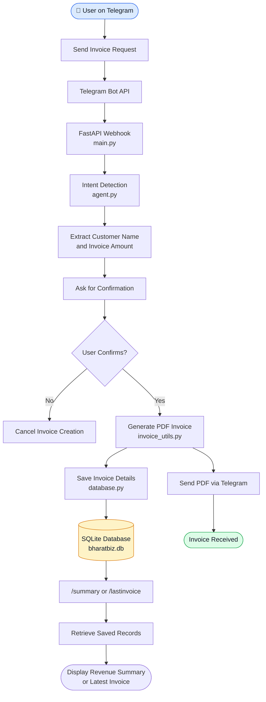

# 🇮🇳 Bharat Biz Agent  
### AI-Powered Business Assistant for Small Businesses

Bharat Biz Agent is an AI-powered Telegram bot that helps small business owners instantly generate professional invoices through simple chat messages. It enables businesses to create, store, and track invoices in real-time using a persistent database system.

---

## 🚀 Problem Statement

Millions of small businesses in India still create invoices manually using paper or Excel sheets. They often do not track revenue properly, lack simple digital tools, and cannot afford expensive accounting software. This results in poor record-keeping and inefficient business operations.

---
## 🔄 System Workflow

The following diagram illustrates how Bharat Biz Agent processes invoice requests, generates PDF invoices, and stores transaction records.




## 💡 Our Solution

Bharat Biz Agent allows small business owners to:

- 🧾 Generate invoices using natural language
- 📄 Automatically create professional PDF invoices
- 📊 Track total revenue using `/summary`
- 🗂 View latest invoice using `/lastinvoice`
- 💾 Store invoice data permanently using SQLite database

All through Telegram — no app installation required.

---

## 🧠 How It Works

1. User sends a message:  
   `Ramesh ke naam ₹500 ka invoice bana do`

2. AI agent detects the intent.

3. Bot asks for confirmation.

4. On "YES":
   - Invoice PDF is generated
   - Data is saved to SQLite database
   - Business statistics are updated
   - PDF is sent to the user

---

## 📊 Available Commands

- `/summary` – View total invoices and total revenue  
- `/lastinvoice` – View latest invoice details  
- `hi` or `/start` – Start interaction  

---

## 🏗️ Tech Stack

- **FastAPI** – Backend framework  
- **Telegram Bot API** – Chat interface  
- **NLP Agent** – Intent detection  
- **SQLite** – Persistent database  
- **ReportLab** – PDF generation  
- **ngrok** – Webhook tunneling  

---

## 📂 Project Structure

```text
Bharat-Biz-Agent/
├── main.py              # FastAPI webhook server
├── agent.py             # AI intent detection logic
├── invoice_utils.py     # PDF invoice generation
├── database.py          # SQLite database operations
├── bharatbiz.db         # SQLite database file (if included)
├── invoices/            # Generated invoice PDFs
├── requirements.txt     # Python dependencies
├── Dockerfile           # Docker configuration (if included)
└── README.md            # Project documentation
```


---

## ⚙️ Installation & Setup

### 2️⃣ Create Virtual Environment

python -m venv venv
venv\Scripts\activate


### 3️⃣ Install Dependencies

pip install -r requirements.txt


### 4️⃣ Create `.env` File

Inside the project folder, create a `.env` file:

BOT_TOKEN=your_telegram_bot_token


### 5️⃣ Run FastAPI Server

python -m uvicorn main:app --reload


### 6️⃣ Start ngrok

ngrok http 8000


Copy the HTTPS URL.

### 7️⃣ Set Telegram Webhook

Open browser and paste:

https://api.telegram.org/bot<YOUR_BOT_TOKEN>/setWebhook?url=<NGROK_URL>/webhook

---

## 🐳 Docker Setup

This project can also be run inside a Docker container.

### Build Docker Image

docker build -t bharat-biz-agent .

### Run Docker Container

docker run -p 8000:8000 bharat-biz-agent

The application will be available at:
http://localhost:8000

---

## 🗄️ Database

This project uses SQLite for persistent storage.

**Why SQLite?**

- Prevents data loss on restart  
- Stores invoice history  
- Enables revenue tracking  
- Makes the MVP production-ready  

---

## 🌍 Future Scope

- GST calculation support  
- UPI QR payment integration  
- Voice-based invoice creation  
- Cloud deployment (AWS / Render)  
- Business analytics dashboard  
- Multi-language support  

---

## 🎯 Impact

This solution can serve:

- 60M+ MSMEs in India  
- Local shop owners  
- Freelancers  
- Street vendors  
- Small traders  

Making digital invoicing accessible and affordable.

---

## 👨‍💻 Hackathon Submission

This project was developed as part of the Online MVP Development Round.  

Bharat Biz Agent demonstrates how AI combined with messaging platforms can empower small businesses with simple and affordable digital tools.

---

